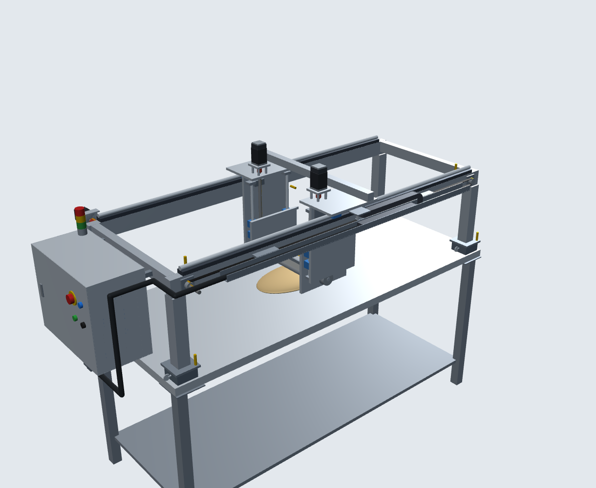
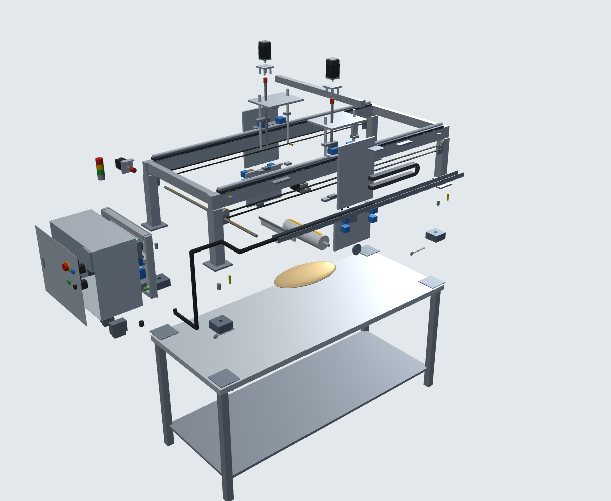
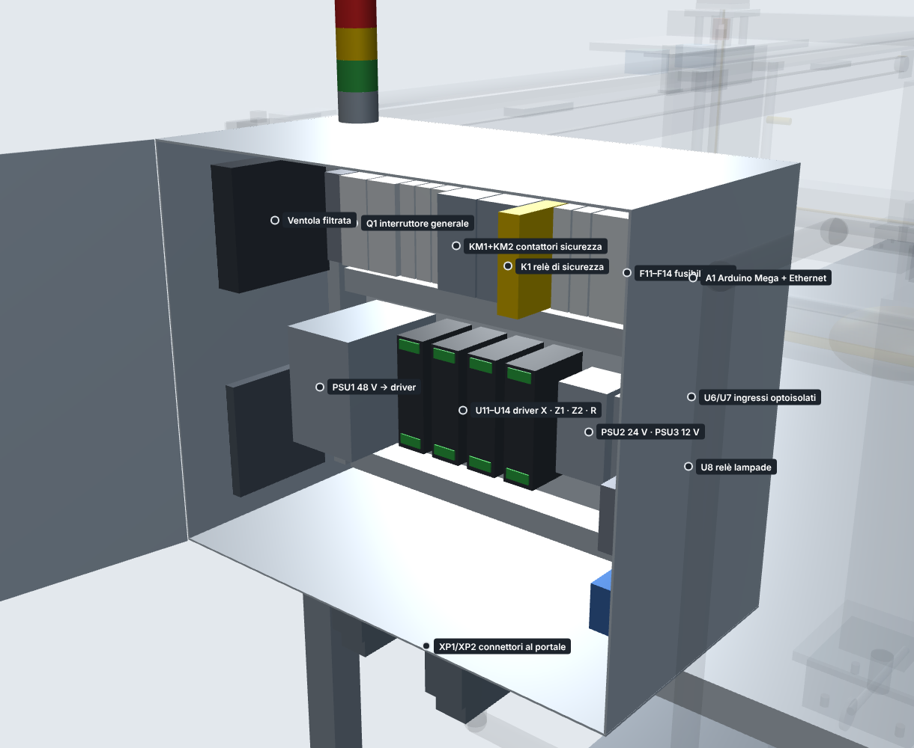
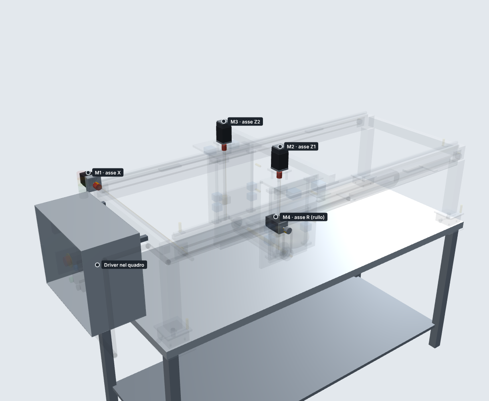

# ManipMasta

Sfogliatrice automatica a portale per tavolo da pasticceria. Un rullo inox trasla avanti e indietro su due guide (come il
carrello di una stampante), scende di qualche millimetro a ogni passata e stende la palla d'impasto messa al centro del tavolo.
Il portale si appoggia su **4 ancoraggi fissi** agli angoli del tavolo e si toglie per la pulizia.
Comando: **Arduino Mega 2560 + Ethernet**, gestione da **VM Linux** (Proxmox) con interfaccia web e **app Android**.




> Le quote sono calcolate su un tavolo ipotetico 2000 × 800 × 900. Inserire le misure reali in `cad/params.json` e rigenerare.

## Modello 3D interattivo

`cad/build/manipmasta_3d.html` (si apre nel browser) ha tre schede:
- **Esplora**: esploso, posizione del rullo, luce rullo–piano, simulazione del ciclo, scheda di ogni pezzo;
- **Come funziona**: dove sono i 4 motori, il motore closed-loop, assi X / Z / R animati, interno del quadro inox con sportello apribile;
- **Montaggio**: le 15 fasi, con i pezzi che entrano in posizione, viteria, coppie e controlli.




## Come funziona

| Asse | Cosa fa | Motore | Trasmissione |
|---|---|---|---|
| X | trasla il rullo lungo il tavolo (corsa ±700 mm) | NEMA23 closed-loop | 2 cinghie HTD-5M con albero di sincronismo |
| Z1, Z2 | alzano/abbassano il rullo = spessore sfoglia (0,5–150 mm) | 2 × NEMA23 closed-loop | viti TR16×4 autobloccanti, homing indipendente (auto-livellamento) |
| R | fa ruotare il rullo alla stessa velocità della traslazione | NEMA23 closed-loop | cinghia 2:1, asservita elettronicamente a X |

Ciclo tipico: rullo alzato al centro → si porta fuori dall'impasto → scende a 40 mm → passata avanti e indietro →
fuori dall'impasto scende di 3 mm → … fino allo spessore finale → passate di finitura → si alza e torna al centro.

## Contenuto del repository

| Cartella | Contenuto |
|---|---|
| [`docs/SPEC.md`](docs/SPEC.md) | **specifica di riferimento**: quote, pinout, protocollo, ciclo |
| [`cad/`](cad/) | modello parametrico (`model.py`), OpenSCAD (`manipmasta.scad`), **3D interattivo con esploso** (`build/manipmasta_3d.html`), **tavole costruttive** (`drawings/ManipMasta_tavole.pdf`), **DXF per laser** (`dxf/`) |
| [`bom/`](bom/) | distinta: `ManipMasta_distinta.xlsx` (fogli Acquisti, Artigiani, Riepilogo) + CSV |
| [`wiring/`](wiring/) | schemi elettrici E01–E05 (`out/schemi_elettrici.pdf`), elenco fili, pinout, procedura di verifica |
| [`firmware/`](firmware/) | firmware Arduino Mega (Arduino IDE / PlatformIO) + test automatici su PC |
| [`server/`](server/) | VM Linux: FastAPI + Mosquitto in Docker, interfaccia web, simulatore della macchina |
| [`android/`](android/) | app Android (Kotlin); l'APK viene compilato da GitHub Actions |
| [`cad/drawings/ManipMasta_montaggio.pdf`](cad/drawings/ManipMasta_montaggio.pdf) | **istruzioni di montaggio** in 15 fasi (immagini esplose, viteria, coppie, controlli) + come funzionano motori e quadro |
| [`docs/`](docs/) | [lavorazioni per artigiani](docs/lavorazioni_artigiani.md), [montaggio e collaudo](docs/montaggio_collaudo.md), [sicurezza](docs/sicurezza.md) |

## Architettura di controllo

```
[App Android] ──HTTPS──┐
[Browser]     ──HTTPS──┤  Nginx Proxy Manager ──► VM Linux (Proxmox)
                       │                           ├─ manipmasta-server (FastAPI :8080, UI web, ricette, storico)
                       │                           └─ mosquitto (:1883, solo VLAN IoT)
                       │                                   ▲ MQTT
                       └───────────────────────────────────┤
                                                   Arduino Mega + Ethernet Shield 2 ──► 4 driver CL57T ──► motori
                                                   (sensori, emergenza, barriera)
```

## Avvio rapido

```bash
# rigenerare disegni e distinta dopo aver cambiato cad/params.json
pip install matplotlib ezdxf openpyxl
python3 cad/model.py && python3 cad/drawings.py && python3 cad/build_viewer.py && python3 bom/bom.py

# test firmware (logica) su PC
cd firmware/test && ./run_tests.sh

# server + simulatore (senza hardware)
cd server && cp .env.example .env && docker compose --profile sim up -d --build
```

Arduino da usare: **Arduino Mega 2560 Rev3** con **Ethernet Shield 2**. Motivi: 16 uscite step/dir/enable + 16 ingressi senza
espansioni, 5 V compatibile con i driver, connessione cablata (più affidabile del Wi-Fi in laboratorio), toolchain stabile.

## Stato e limiti

- Progetto concettuale completo, non ancora costruito. Le forature marcate **[V]** vanno verificate sui componenti acquistati.
- Il firmware è verificato con 392 controlli automatici su PC (mock dell'hardware), non ancora su scheda reale.
- L'APK Android viene compilato da GitHub Actions al primo push: controllare l'esito nella scheda *Actions*.
- Prima dell'uso con operatori: valutazione dei rischi e verifica da tecnico abilitato ([sicurezza](docs/sicurezza.md)).
